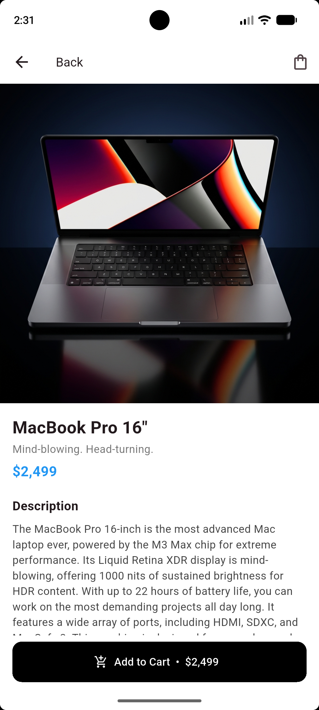
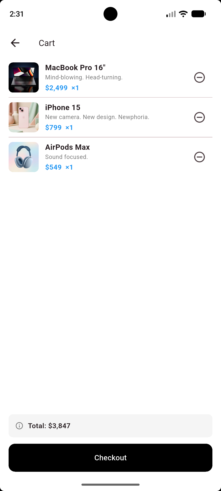
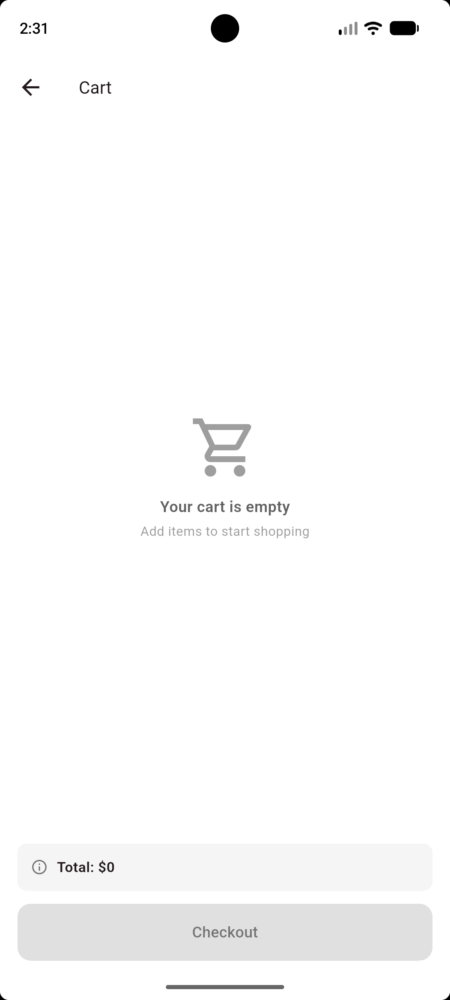

# Mini Katalog

Flutter ile geliştirilmiş, temel seviyede bir **Mini Katalog Uygulaması**. Ürünler listelenir, aranır, detayı görüntülenir ve basit bir sepete eklenir.

> Ürün verileri ve görseller eğitim/demo amaçlıdır (wantapi.com). Gerçek bir e-ticaret altyapısını temsil etmez.

## Kullanılan Flutter Sürümü

`<< Flutter 3.47.7 • Dart 3.13.5>>`

## Özellikler

- **Ana sayfa (Discover):** arama kutusu, banner ve `GridView` ile ürün kartları
- **Arama / filtreleme:** yazdıkça ürün adı ve sloganına göre filtreler
- **Ürün detayı:** büyük görsel, açıklama ve özellikler (Route Arguments ile ürün taşınır)
- **Sepet:** ekleme, çıkarma, adet, toplam tutar, Checkout (simülasyon), boş sepet ekranı
- **Navigasyon:** Named Routes (`/`, `/detail`, `/cart`)
- **Veri:** `assets/products.json` -> `Product.fromJson` / `toJson`
- **Ekstra paket yok:** sadece `material.dart`

## Klasör Yapısı

```
lib/
  main.dart                  # uygulama girişi ve route tanımları
  models/product.dart        # Product model sınıfı (fromJson / toJson)
  data/cart_state.dart       # ValueNotifier ile basit sepet yönetimi
  utils/format.dart          # fiyat biçimlendirme
  screens/
    home_screen.dart
    detail_screen.dart
    cart_screen.dart
  widgets/
    product_card.dart
    product_image.dart
    cart_icon_button.dart
assets/
  products.json
  images/
screenshots/
```

## Çalıştırma Adımları

1. Flutter SDK kurulu olmalı: `flutter doctor`
2. Projeyi klonlayın: `git clone <REPO_URL>`
3. Klasöre girin: `cd mini_katalog`
4. Bağımlılıkları yükleyin: `flutter pub get`
5. Emulator'ü açın veya Android cihazı bağlayın
6. Çalıştırın: `flutter run`

> Görsellerin görünmesi için cihazın internete bağlı olması gerekir.

## Ekran Görüntüleri

| Ana Sayfa | Detay | Sepet | Boş Sepet |
|---|---|---|---|
|  |  |  |  |
